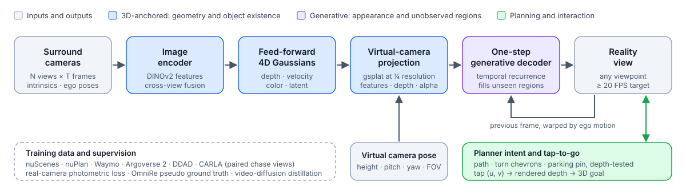

<div align="center">

# Open Reality View

**Feed-forward generative 3D driving visualization from surround cameras, built in the open.**

[Project page](https://openrealityview.github.io/open-reality-view/) ·
[Roadmap](ROADMAP.md) ·
[中文说明](README_zh-CN.md)

[](https://github.com/OpenRealityView/open-reality-view/actions/workflows/ci.yml)
[](LICENSE)


</div>

<p align="center">
  
</p>

> [!NOTE]
> Pre-alpha. This repository holds the project scaffold: interfaces, a CPU-runnable toy pipeline, tests and the project page. Models, checkpoints and demos are released milestone by milestone; see the [roadmap](ROADMAP.md).

## What is this?

With FSD v15 (November 2026), Tesla introduced *Reality View*: a real-time generative view of the car's surroundings, streamed from a virtual camera above the vehicle and rendered by the same end-to-end network that drives the car. No game engine, no hand-assembled perception widgets ([release notes, via Not a Tesla App](https://www.notateslaapp.com/software-updates/version/2026.38.6.11/release-notes)).

Open Reality View (ORV) is an independent open-source effort to build this class of system from public data and open components:

- **Feed-forward.** One network pass turns surround-camera video into a 3D-anchored scene. No per-scene optimization.
- **Generative.** A light one-step decoder turns a low-resolution render of that scene into a clean full-resolution frame and fills in what no camera saw.
- **Free viewpoint.** Any virtual camera around and above the ego vehicle, including top-down.
- **Multi-dataset.** One data contract for nuScenes, nuPlan, Waymo, Argoverse 2, DDAD and KITTI; any calibrated rig, from a front stereo pair to 8 surround cameras.
- **Faithful.** Object existence and geometry come from the 3D anchors, never from the generator. Faithfulness is the headline metric.
- **Real-time.** Target: ≥ 20 FPS on a single consumer GPU.

## How it works

| Stage | What happens | Initial building blocks |
|---|---|---|
| 1. Lift | N cameras × T frames → image encoder → pixel-aligned 3D Gaussians with color, latent features and velocity | DINOv2, STORM-style heads |
| 2. Project | Rasterize color, latent features, depth and alpha into the virtual camera at ¼ resolution | gsplat |
| 3. Generate | One-step decoder with temporal recurrence (previous output warped by ego motion) → full-resolution frame | U-Net decoder, Difix3D+-style refinement, DMD / Self-Forcing distillation |
| 4. Interact | Planned path, turn chevrons and parking pins drawn in 3D with depth testing; a tap on the view → depth → 3D goal | NAVSIM, GoalFlow |

No real camera exists at the virtual viewpoint, so training combines photometric self-supervision on the real cameras, pseudo ground truth from offline 4D reconstruction (DriveStudio / OmniRe), paired simulator data (CARLA) and distillation from video-diffusion teachers, weighted by per-pixel confidence. Milestones and metrics are in the [roadmap](ROADMAP.md).

## Supported datasets

ORV is multi-dataset by design. Each adapter converts its dataset into one `SurroundSample` contract: N synchronized cameras × T frames with intrinsics, camera-to-ego extrinsics and ego poses, in a single convention (ego frame x forward, y left, z up with the origin on the ground below the rear axle; OpenCV cameras; meters and seconds). Nothing after the adapter is dataset-specific.

| Dataset | Cameras | Scale | Role in ORV | License |
|---|---|---|---|---|
| [nuScenes](https://www.nuscenes.org/nuscenes) | 6 × 1600×900 @ 12 Hz | 1,000 scenes × 20 s, Boston and Singapore | Core training set; rich 3D labels for faithfulness evaluation | CC BY-NC-SA 4.0 |
| [nuPlan](https://www.nuscenes.org/nuplan) / [NAVSIM](https://github.com/autonomousvision/navsim) | 8 @ 10 Hz | 120 h of sensor data out of ~1,200 h, 4 cities | Scale; joint rendering and planning, tap-to-go | CC BY-NC-SA 4.0 |
| [Waymo Open Perception](https://waymo.com/open/) | 5 @ 10 Hz, no rear camera | 1,150 scenes × 20 s | Best pseudo ground truth (5 LiDARs); the missing rear view tests generative completion | Waymo non-commercial license |
| [Argoverse 2 Sensor](https://www.argoverse.org/av2.html) | 7 ring × 2048×1550 @ 20 Hz | 1,000 scenarios × 15 s, 6 US cities | Cross-city generalization; rig with a portrait front camera | CC BY-NC-SA 4.0 |
| [DDAD](https://github.com/TRI-ML/DDAD) | 6 × 1936×1216 @ 10 Hz, global shutter | 200 scenes (150 train / 50 val), US and Japan | Dense long-range depth (LiDAR up to 250 m) | CC BY-NC-SA 4.0 |
| [KITTI](https://www.cvlibs.net/datasets/kitti/) | 2 color (front stereo) @ 10 Hz | Raw recordings and 22 odometry sequences, Karlsruhe (city, rural, highway) | Narrowest rig: most of the chase view must be generated; comparison with classic depth and view-synthesis work | CC BY-NC-SA 3.0 |

- **Any rig.** The lifter predicts Gaussians per camera pixel and fuses views in 3D, so any calibrated rig, from KITTI's front stereo pair to nuPlan's 8 surround cameras, runs through the same network. Virtual cameras are defined in the ego frame, so a chase view means the same thing on every dataset.
- **Mixed training.** Batches are drawn per dataset and interleaved, so rigs with different camera counts and resolutions train one model.
- **Cross-dataset evaluation.** Metrics are reported per dataset and leave-one-dataset-out: train on the others, test on an unseen rig and unseen cities.
- **Licensing.** All of these datasets are licensed for non-commercial use only. Checkpoints are released per training mix and inherit its most restrictive terms; weights trained on Waymo are shared only under the Waymo Dataset License.

LiDAR is used only as training-time supervision; inference is camera-only. Adapter progress is tracked in the [roadmap](ROADMAP.md) (M0).

## Repository layout

```text
orv/                  Python package
├── geometry.py       cameras, virtual chase-camera family, depth-based warping
├── data/             data contract (SurroundSample), synthetic inputs, dataset adapters
├── models/           encoder, feed-forward Gaussian lifter, renderer, decoder, pipeline
├── eval/             metrics, incl. detect-on-render faithfulness
└── cli.py            `orv info`, `orv smoke`
configs/              debug (CPU toy) and MVP configurations
tests/                pytest suite, runs on CPU
docs/                 project page, deployed with GitHub Pages
```

## Getting started

Python ≥ 3.10 and PyTorch ≥ 2.1. The real renderer needs CUDA and [gsplat](https://github.com/nerfstudio-project/gsplat); everything else runs on CPU.

```bash
git clone https://github.com/OpenRealityView/open-reality-view.git
cd open-reality-view
pip install torch --index-url https://download.pytorch.org/whl/cpu  # or a CUDA build, see pytorch.org
pip install -e ".[dev]"            # on a CUDA machine: pip install -e ".[dev,render]"

orv info                               # environment check
orv smoke --config configs/debug.yaml  # toy forward pass on synthetic inputs
pytest
```

## Building blocks

ORV re-implements or depends on the projects below. Code under non-permissive licenses is used as a reference design or an optional dependency, never vendored.

| Project | Role | License |
|---|---|---|
| [gsplat](https://github.com/nerfstudio-project/gsplat) | Gaussian rasterization | Apache-2.0 |
| [DINOv2](https://github.com/facebookresearch/dinov2) | Image encoder | Apache-2.0 |
| [STORM](https://github.com/NVlabs/GaussianSTORM) | Feed-forward dynamic Gaussians (reference design) | NVIDIA License |
| [DriveStudio / OmniRe](https://github.com/ziyc/drivestudio) | Offline pseudo ground truth | MIT |
| [Difix3D+](https://github.com/nv-tlabs/Difix3D) | Single-step artifact removal (reference design) | NVIDIA License |
| [Self-Forcing](https://github.com/guandeh17/Self-Forcing) | Autoregressive distillation recipe | Apache-2.0 |
| [NAVSIM](https://github.com/autonomousvision/navsim) | Planning benchmark | Apache-2.0 |
| [GoalFlow](https://github.com/YvanYin/GoalFlow) | Goal-conditioned planning | Apache-2.0 |

## Contributing

Contributions are welcome. Please read [CONTRIBUTING.md](CONTRIBUTING.md) and the [Code of Conduct](CODE_OF_CONDUCT.md).

## Citation

```bibtex
@misc{openrealityview2026,
  title        = {Open Reality View: Feed-forward Generative 3D Driving Visualization},
  author       = {{Open Reality View contributors}},
  year         = {2026},
  howpublished = {\url{https://github.com/OpenRealityView/open-reality-view}}
}
```

## License

Code is released under the [Apache License 2.0](LICENSE). Third-party code, checkpoints and datasets keep their own licenses.

## Disclaimer

Open Reality View is an independent open-source research project. It is not affiliated with, endorsed by or sponsored by Tesla, Inc. Tesla, FSD and Reality View are mentioned only to describe the product that inspired this work; all trademarks belong to their owners. This is research software and must not be used to operate a vehicle or in any safety-critical system.
