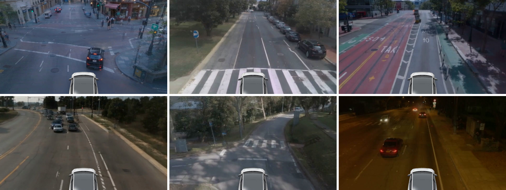
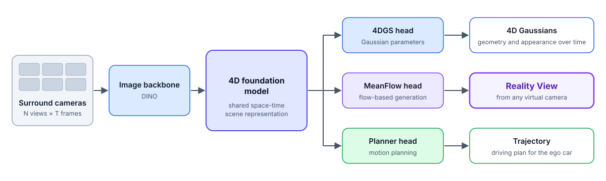

# Open Reality View

**Feed-forward generative 3D driving visualization from surround cameras.** 
Any virtual camera. Real time. Faithful to what the cameras saw.

**Jiang Anqing**\*† · **Hai Yang** · **Su Wenliang** · **Yang Chen** · **Sun Hao**✉

Bosch Corporate Research

\* First author · † Project leader · ✉ Corresponding author

[Project page](https://openrealityview.github.io/open-reality-view/) ·
[Demos](https://openrealityview.github.io/open-reality-view/#demos) ·
Paper (coming soon) ·
Models (coming soon) ·
[中文说明](README_zh-CN.md)

  
   
  <em>Chase views from a virtual camera above and behind the car on Waymo, Argoverse 2, DDAD and nuPlan, day and night. Videos are on the <a href="https://openrealityview.github.io/open-reality-view/">project page</a>.</em>

## Overview & Method

  

> With FSD v15, Tesla introduced Reality View: a real-time generative view of the car's surroundings, streamed from a virtual camera above the vehicle and rendered by the same end-to-end network that drives it.

Open Reality View builds this class of system in the open, from public data and open components. Surround-camera video is encoded by a DINO image backbone, and a 4D foundation model fuses the features across cameras and time into one shared scene representation. Three heads read from it in parallel: a 4DGS head predicts 4D Gaussians of the scene, a MeanFlow head generates the Reality View from any virtual camera, and a planner head outputs the driving trajectory. The view and the driving decisions come from the same model.

## Datasets

One data contract, many rigs. ORV trains and evaluates on nuScenes, nuPlan, Waymo, Argoverse 2, DDAD and KITTI.

Every adapter emits the same `SurroundSample`: synchronized cameras with intrinsics, camera-to-ego extrinsics and ego poses in one convention. The model takes any calibrated rig, from a front stereo pair to 8 surround cameras, a chase view means the same thing on every dataset, and results are reported per dataset and leave-one-dataset-out, on rigs and cities the model has never seen.

| Dataset | Rig | Role | License |
|---|---|---|---|
| [nuScenes](https://www.nuscenes.org/nuscenes) | 6 cameras · 12 Hz · 1,000 scenes · Boston, Singapore | Core training set; rich 3D labels for faithfulness evaluation. | CC BY-NC-SA 4.0 |
| [nuPlan / NAVSIM](https://www.nuscenes.org/nuplan) | 8 cameras · 10 Hz · 120 h of sensor data · 4 cities | Scale, plus joint rendering and planning and tap-to-go on NAVSIM. | CC BY-NC-SA 4.0 |
| [Waymo Open Perception](https://waymo.com/open/) | 5 cameras · 10 Hz · 1,150 scenes · no rear camera | Best pseudo ground truth from 5 LiDARs; the missing rear view tests generative completion. | Waymo non-commercial |
| [Argoverse 2 Sensor](https://www.argoverse.org/av2.html) | 7 ring cameras · 20 Hz · 1,000 scenarios · 6 US cities | Cross-city generalization on a rig with a portrait front camera. | CC BY-NC-SA 4.0 |
| [DDAD](https://github.com/TRI-ML/DDAD) | 6 cameras · 10 Hz · global shutter · US and Japan | Dense long-range depth from LiDAR reaching 250 m. | CC BY-NC-SA 4.0 |
| [KITTI](https://www.cvlibs.net/datasets/kitti/) | 2 front color cameras (stereo) · 10 Hz · 64-beam LiDAR · Karlsruhe | The narrowest rig: most of the chase view must be generated; links ORV to classic depth and view-synthesis benchmarks. | CC BY-NC-SA 3.0 |

All of these datasets are licensed for non-commercial use only; every released checkpoint states the license of its training data.

## Demos

Front view and chase view of the same clip, two clips per dataset on nuScenes, nuPlan, Waymo, Argoverse 2 and DDAD. The chase view comes from a virtual camera above and behind the car; the ego car is added as a 3D model.

**Free viewpoint.** The same drive from a virtual camera that circles the car (orbit) or swings from one side of it to the other (swing), on Argoverse 2 and Waymo.

All videos are on the [project page](https://openrealityview.github.io/open-reality-view/#demos).

## Status

This repository hosts the project page. Code, pretrained models and the paper are coming soon.

## License

Code is released under the [Apache License 2.0](LICENSE). Third-party code, checkpoints and datasets keep their own licenses.

## Disclaimer

Open Reality View is an independent open-source research project. It is not affiliated with, endorsed by or sponsored by Tesla, Inc. Tesla, FSD and Reality View are mentioned only to describe the product that inspired this work; all trademarks belong to their owners. This is research software and must not be used to operate a vehicle or in any safety-critical system.
