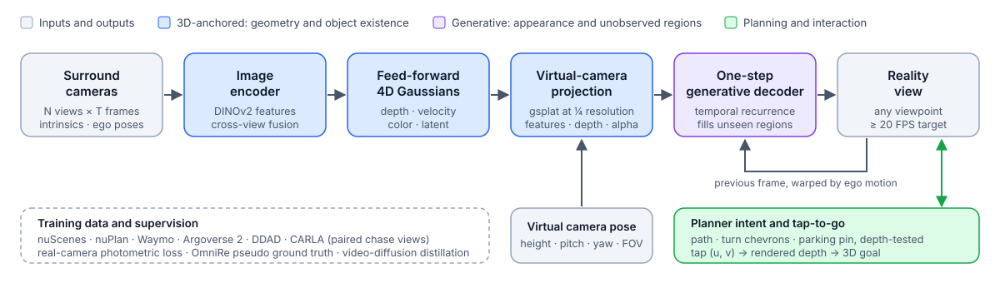

<div align="center">

# Open Reality View

**基于环视相机的前馈式生成 3D 驾驶可视化，完全开源。**

[项目主页](https://openrealityview.github.io/open-reality-view/) ·
[路线图](ROADMAP.md) ·
[English](README.md)

[](https://github.com/OpenRealityView/open-reality-view/actions/workflows/ci.yml)
[](LICENSE)


</div>

<p align="center">
  
</p>

> [!NOTE]
> 早期阶段（pre-alpha）。仓库目前包含项目骨架：接口定义、可在 CPU 上运行的玩具流水线、测试和项目主页。模型、权重和演示将按里程碑逐步发布，见[路线图](ROADMAP.md)。

## 这是什么？

Tesla 在 2026 年 11 月的 FSD v15 中推出了 *Reality View*：从车辆上方的虚拟相机实时生成周围环境的画面，由驾驶所用的同一个端到端网络渲染，不依赖游戏引擎，也不再拼接各类感知结果（[发布说明，Not a Tesla App 转录](https://www.notateslaapp.com/software-updates/version/2026.38.6.11/release-notes)）。

Open Reality View（ORV）是一个独立的开源项目，目标是用公开数据和开源组件构建同类系统：

- **前馈**：一次前向推理把环视视频变成 3D 锚定的场景，无需逐场景优化。
- **生成式**：轻量的单步解码器把场景的低分辨率渲染变成干净的全分辨率画面，并补全任何相机都没有看到的区域。
- **自由视角**：自车周围和上方的任意虚拟相机，包括俯视。
- **多数据集**：nuScenes、nuPlan、Waymo、Argoverse 2、DDAD 和仿真数据共用一套数据契约，支持 5 到 8 路相机和任意标定。
- **忠实**：物体是否存在、几何形状都由 3D 锚点决定，生成器从不"造物"。忠实度是首要指标。
- **实时**：目标是单张消费级 GPU 上 ≥ 20 FPS。

## 工作原理

| 阶段 | 内容 | 初始组件 |
|---|---|---|
| 1. 升维 | N 路相机 × T 帧 → 图像编码器 → 带颜色、潜特征和速度的像素对齐 3D 高斯 | DINOv2、STORM 式预测头 |
| 2. 投影 | 以 ¼ 分辨率把颜色、潜特征、深度和 alpha 光栅化到虚拟相机 | gsplat |
| 3. 生成 | 带时序递归（上一帧输出按自车运动 warp）的单步解码器 → 全分辨率画面 | U-Net 解码器、Difix3D+ 式精修、DMD / Self-Forcing 蒸馏 |
| 4. 交互 | 规划路径、转向箭头和泊车 pin 在 3D 中绘制并做深度测试；点击画面 → 深度 → 3D 目标 | NAVSIM、GoalFlow |

虚拟视角处没有真实相机，因此训练信号组合了：真实相机上的光度自监督、离线 4D 重建伪真值（DriveStudio / OmniRe）、仿真配对数据（CARLA）和视频扩散教师蒸馏，并按每像素置信度加权。里程碑和评测指标见[路线图](ROADMAP.md)。

## 支持的数据集

ORV 从设计上就面向多数据集。每个适配器都把数据集转换成统一的 `SurroundSample` 数据契约：N 路同步相机 × T 帧，附带内参、相机到自车的外参和自车位姿，并采用同一套约定（自车坐标系 x 向前、y 向左、z 向上，原点在后轴中心正下方的地面；相机为 OpenCV 约定；单位为米和秒）。适配器之后的所有模块都与具体数据集无关。

| 数据集 | 相机 | 规模 | 在 ORV 中的作用 | 许可证 |
|---|---|---|---|---|
| [nuScenes](https://www.nuscenes.org/nuscenes) | 6 × 1600×900 @ 12 Hz | 1,000 个场景 × 20 s，波士顿、新加坡 | 主力训练集；丰富的 3D 标注用于忠实度评测 | CC BY-NC-SA 4.0 |
| [nuPlan](https://www.nuscenes.org/nuplan) / [NAVSIM](https://github.com/autonomousvision/navsim) | 8 路 @ 10 Hz | 约 1,200 h 驾驶数据，其中 120 h 含传感器数据，4 座城市 | 数据规模；渲染与规划联合训练、点击即达 | CC BY-NC-SA 4.0 |
| [Waymo Open Perception](https://waymo.com/open/) | 5 路 @ 10 Hz，无后视相机 | 1,150 个场景 × 20 s | 伪真值质量最好（5 个 LiDAR）；缺少后视可检验生成式补全 | Waymo 非商业许可 |
| [Argoverse 2 Sensor](https://www.argoverse.org/av2.html) | 7 路环视 2048×1550 @ 20 Hz | 1,000 个场景 × 15 s，美国 6 座城市 | 跨城市泛化；前视相机为竖幅 | CC BY-NC-SA 4.0 |
| [DDAD](https://github.com/TRI-ML/DDAD) | 6 × 1936×1216 @ 10 Hz，全局快门 | 200 个场景（训练 150 / 验证 50），美国和日本 | 远距离稠密深度（LiDAR 最远 250 m） | CC BY-NC-SA 4.0 |
| [CARLA](https://github.com/carla-simulator/carla) | 任意相机配置 + 追尾相机 | 仿真 | 追尾视角精确真值；点击即达闭环评测 | MIT（代码）、CC-BY（资产） |

- **任意相机配置**：升维网络按相机像素预测高斯并在 3D 中融合，5、6、7、8 路相机和任意标定都走同一个网络。虚拟相机定义在自车坐标系下，同一个追尾视角在各数据集上含义一致。
- **混合训练**：按数据集分别采样 batch 并交替训练，相机数量和分辨率不同的数据共同训练一个模型。
- **跨数据集评测**：指标按数据集分别报告，并做留一数据集评测：在其余数据集上训练，在未见过的相机配置和城市上测试。
- **许可证**：上述数据集大多仅允许非商业使用。权重按训练数据组合分别发布，并继承其中最严格的条款；用 Waymo 训练的权重只按 Waymo Dataset License 分享。

LiDAR 只作训练期监督，推理只用相机。适配器进度见[路线图](ROADMAP.md)（M0）。

## 目录结构

```text
orv/                  Python 包
├── geometry.py       相机模型、虚拟追尾相机族、基于深度的 warp
├── data/             数据契约（SurroundSample）、合成输入、数据集适配器
├── models/           编码器、前馈高斯升维、渲染器、解码器、完整流水线
├── eval/             评测指标，含 detect-on-render 忠实度
└── cli.py            `orv info`、`orv smoke`
configs/              debug（CPU 玩具）和 MVP 配置
tests/                pytest 测试，CPU 可运行
docs/                 项目主页，由 GitHub Pages 发布
```

## 快速开始

需要 Python ≥ 3.10 和 PyTorch ≥ 2.1。真正的渲染器需要 CUDA 和 [gsplat](https://github.com/nerfstudio-project/gsplat)，其余部分都能在 CPU 上运行。

```bash
git clone https://github.com/OpenRealityView/open-reality-view.git
cd open-reality-view
pip install torch --index-url https://download.pytorch.org/whl/cpu  # 或按 pytorch.org 安装 CUDA 版本
pip install -e ".[dev]"            # CUDA 机器：pip install -e ".[dev,render]"

orv info                               # 检查环境
orv smoke --config configs/debug.yaml  # 用合成输入跑一次玩具前向
pytest
```

## 依赖的开源项目

ORV 会复现或依赖下列项目。非宽松许可证的代码只作为参考设计或可选依赖，不会拷贝进本仓库。

| 项目 | 作用 | 许可证 |
|---|---|---|
| [gsplat](https://github.com/nerfstudio-project/gsplat) | 高斯光栅化 | Apache-2.0 |
| [DINOv2](https://github.com/facebookresearch/dinov2) | 图像编码器 | Apache-2.0 |
| [STORM](https://github.com/NVlabs/GaussianSTORM) | 前馈动态高斯（参考设计） | NVIDIA License |
| [DriveStudio / OmniRe](https://github.com/ziyc/drivestudio) | 离线伪真值 | MIT |
| [Difix3D+](https://github.com/nv-tlabs/Difix3D) | 单步去伪影（参考设计） | NVIDIA License |
| [Self-Forcing](https://github.com/guandeh17/Self-Forcing) | 自回归蒸馏方法 | Apache-2.0 |
| [NAVSIM](https://github.com/autonomousvision/navsim) | 规划评测基准 | Apache-2.0 |
| [GoalFlow](https://github.com/YvanYin/GoalFlow) | 目标条件规划 | Apache-2.0 |

## 参与贡献

欢迎贡献，请先阅读 [CONTRIBUTING.md](CONTRIBUTING.md) 和[行为准则](CODE_OF_CONDUCT.md)。

## 引用

```bibtex
@misc{openrealityview2026,
  title        = {Open Reality View: Feed-forward Generative 3D Driving Visualization},
  author       = {{Open Reality View contributors}},
  year         = {2026},
  howpublished = {\url{https://github.com/OpenRealityView/open-reality-view}}
}
```

## 许可证

代码以 [Apache License 2.0](LICENSE) 发布。第三方代码、权重和数据集沿用各自的许可证。

## 免责声明

Open Reality View 是独立的开源研究项目，与 Tesla, Inc. 不存在任何隶属、认可或赞助关系。文中提及 Tesla、FSD 和 Reality View 仅用于说明启发本项目的产品，相关商标归其所有者。本项目是研究软件，不得用于驾驶车辆或任何安全关键系统。
